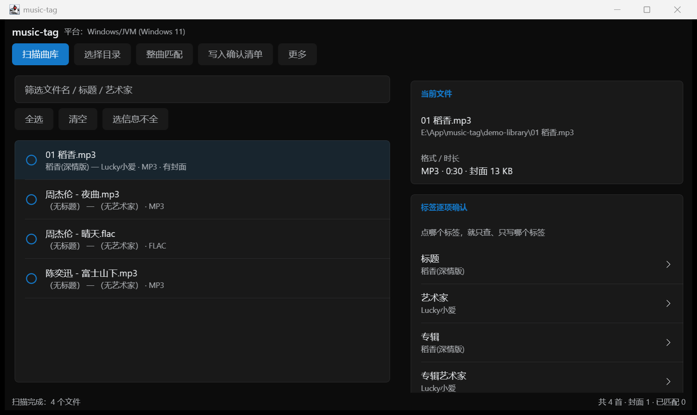
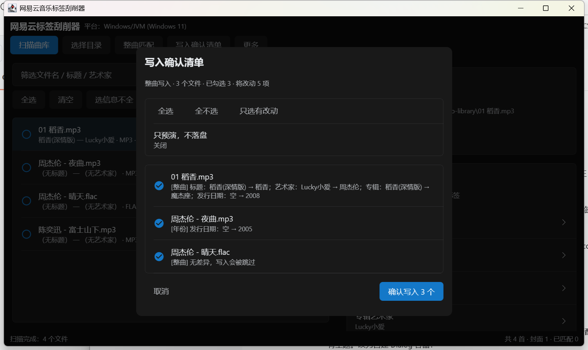

# 网易云音乐标签刮削器 · Compose Multiplatform + SaltUI

[](https://github.com/2744317644/music-tag/actions/workflows/ci.yml)
[](https://github.com/2744317644/music-tag/actions/workflows/release.yml)
[](LICENSE)

一套 **Kotlin Multiplatform + Compose Multiplatform** 工程，目标平台 **Windows / Android / iOS**。
界面使用 [SaltUI](https://github.com/Moriafly/SaltUI)（Salt Player 的组件库），
加密、接口、标签读写、匹配、人工确认清单全部在 `commonMain`，三端共用同一份代码。

仓库：<https://github.com/2744317644/music-tag>






> 与 `E:\App\NeteaseTagger`（.NET 8 WinForms 版）并存，互不影响。

---

## 立即可用：Windows 桌面版

```powershell
java -jar E:\App\NeteaseTagger-KMP\out\NeteaseTagger.jar
```

**需要 JDK 21+**（本机已装在 `D:\jdk21`）。原因见「为什么要 JDK 21」。
或者直接双击/运行 `run.ps1`。

从源码构建（已带 Gradle wrapper，首次会自动下载 Gradle 8.13）：

```powershell
$env:JAVA_HOME = "D:\jdk21"
git clone https://github.com/2744317644/music-tag.git
cd music-tag

.\gradlew.bat :desktopApp:run          # 直接运行
.\gradlew.bat :desktopApp:fatJar       # 免安装 jar → desktopApp/build/libs/
.\gradlew.bat :shared:jvmTest          # 全部测试
```

macOS / Linux 用 `./gradlew …`。

---

## 验证到什么程度

| 项目 | 状态 | 证据 |
| --- | --- | --- |
| Gradle KMP 工程 | ✅ 构建通过 | `BUILD SUCCESSFUL` |
| 纯 Kotlin AES-128 | ✅ 标准向量 | FIPS-197 + NIST SP800-38A，6 项 |
| MD5 / RSA-1024 | ✅ 参考值比对 | 与 Python `pow(m,65537,n)` 逐字节一致，10 项 |
| 网易云接口 | ✅ 真实联调 | 真实搜索/详情/歌词，2 项 |
| MP3 / FLAC / M4A 标签读写 | ✅ 写入+回读+二次写入 | 10 字段全对，含封面/歌词，8 项 |
| **确认清单语义** | ✅ **未勾选绝不写入** | 5 项：预演/部分勾选/全不勾选逐个验证 |
| 桌面界面（SaltUI） | ✅ 实际启动并截图 | 见上方两张截图 |
| Android 构建 | ⚠️ 代码完整，本机无 SDK 未验证 | 装 SDK 后 `:androidApp:assembleDebug` |
| iOS 构建 | ⚠️ 代码完整，需 macOS+Xcode | Windows 上该任务 SKIPPED |

**测试总计 31 项，全部通过。**

---

## 界面：为什么用 SaltUI

SaltUI 是 Compose Multiplatform 的组件库（Android/Desktop/iOS 同源），风格即 Salt Player：

| 用到的组件 | 用在哪 |
| --- | --- |
| `SaltTheme` + `saltConfigs(isDarkTheme = true)` | 全局深色主题、配色、圆角、间距 |
| `Button(type = Highlight/Sub)` | 顶栏操作、对话框按钮（蓝色高亮=主操作） |
| `ItemCheck` | 曲目多选列表、确认清单逐条勾选 |
| `Item` + `ItemArrowType.Arrow` | 「标签逐项确认」每一行（点哪行就查哪个字段） |
| `ItemTitle` / `ItemTip` | 分区标题与说明（强调蓝 + 弱化灰） |
| `RoundedColumn` | 分组卡片容器（Salt 的标志性分组） |
| `ItemValue` + `SelectionContainer` | 文件信息、歌词（可选中复制） |
| `ItemDivider` / `ItemSpacer` | 分隔与间距，跟 Salt 尺寸体系一致 |
| `PopupMenu` + `Item` | 顶栏「更多」菜单 |
| `Text` / `SaltSubText` | 统一走 Salt 的 textStyles.main/sub |
| `dialog.DialogTitle` | 对话框标题 |

两点踩坑记录（都已修掉）：

1. **对话框会丢主题** —— Compose 的 `Dialog` 是独立 composition，不继承外层 `SaltTheme`。
   SaltUI 的 `BasicDialog` 在自己的 composition 里解析 `SaltTheme.colors`，那时主题还没生效，
   会出现白底 + 深色字（白底白字看不清）。所以 `SaltDialogViews.kt` 里自己搭了对话框容器，
   配色强制跟着 `TaggerTheme` 走。
2. **SaltUI 2.5.2 的 desktop 产物是 Java 21 编译的**（class file 65）。跑在 JDK 17 上会抛
   `UnsupportedClassVersionError`。所以运行时必须是 JDK 21+。
   选 2.5.2 是因为它依赖 Compose 1.8.2 + Kotlin 2.1.21，与本工程完全对齐，不用动工具链。

---

## 用法：逐字段查找 → 勾选确认 → 才写入

1. 顶部 **选择目录** → **扫描曲库**（有上次目录会自动扫描）
2. 左侧点一首歌（列表行可勾选，用于批量匹配）
3. 右侧「标签逐项确认」里点某个标签 —— **只按这个标签去网易云搜**
   - 音轨号会按专辑曲目对到你这一首，不是盲取第一首
   - 歌词可选「原文 / 翻译 / 双语」
4. 在「查找结果」里点一条候选 → 生成待写清单（**此时不落盘**）
5. 点顶部 **写入确认清单** → 逐条勾选 → **确认写入**

关键语义（`PendingServiceTest` 5 项测试钉死）：
- 生成清单阶段文件字节不变
- 没勾选的条目**绝不写入**，文件字节不变
- 只勾一部分时，未勾选的文件也完全不动
- 「只预演」模式下文件不被修改
- 同一文件的多个字段会**合并成一条**清单，不会重复写

---

## 工程结构

```
NeteaseTagger-KMP/
├─ shared/
│  └─ src/
│     ├─ commonMain/kotlin/app/tagger/
│     │  ├─ core/                       # 业务核心（三端共享）
│     │  │  ├─ Aes.kt                   # 纯 Kotlin AES-128（CBC/ECB + PKCS#7）
│     │  │  ├─ Crypto.kt                # MD5 / RSA-1024 / Base64 / 随机密钥
│     │  │  ├─ NeteaseCrypto.kt         # weapi / eapi 请求体加密
│     │  │  ├─ NeteaseClient.kt         # Ktor 客户端：多端点轮询 + TTL 缓存
│     │  │  ├─ Library.kt               # 扫描、文件名解析、打分、歌词合并
│     │  │  ├─ SearchService.kt         # 按字段查找、整曲匹配
│     │  │  ├─ PendingService.kt        # 待写清单 + 人工确认 + 落盘
│     │  │  ├─ AppSettings.kt           # 设置与运行日志
│     │  │  └─ tags/                    # 自研标签引擎
│     │  │     ├─ TagEngine.kt          # 格式分派 + 读写 + 备份 + 回读校验
│     │  │     ├─ Id3v2.kt              # MP3：ID3v2.3/2.4、APIC、USLT
│     │  │     ├─ Vorbis.kt             # FLAC/OGG：Vorbis Comment、PICTURE
│     │  │     └─ Mp4Tags.kt            # M4A：ilst 原子（covr/trkn/disk）
│     │  └─ ui/                         # SaltUI 界面（三端共享）
│     │     ├─ SaltMainApp.kt           # 主界面：曲目表 + 字段确认 + 候选
│     │     ├─ SaltTopBar.kt            # 顶栏 + 状态栏
│     │     ├─ SaltDialogViews.kt       # 目录选择 / 写入确认清单
│     │     ├─ Theme.kt                 # SaltTheme 封装 + 文本框 + 时长格式化
│     │     └─ TaggerState.kt           # 状态与动作（StateFlow）
│     ├─ jvmMain/  androidMain/  iosMain/   # 三端 actual
│     ├─ commonTest/                    # 加密 / 解析 / 打分
│     └─ jvmTest/                       # 真实文件 + 真实接口 + 确认语义
├─ desktopApp/                          # Windows / macOS / Linux 入口
├─ androidApp/                          # Android 入口（有 SDK 时自动纳入构建）
├─ iosApp/                              # iOS 入口（SwiftUI + xcodegen 配置）
├─ demo-library/                        # 本地演示曲库（已 gitignore，不入库）
└─ docs/                                # 截图
```

---

## 技术要点

### 为什么自己实现 AES / MD5 / RSA

KMP 没有三端统一的加密 API（JVM 用 JCA、iOS 用 CommonCrypto、Android 另一套）。
自实现保证三端行为一致，且能直接在 JVM 上跑标准向量测试。
RSA 与 Python 参考实现逐字节比对。

### 为什么自己实现标签解析器

iOS 上没有可用标签库；桌面用 jaudiotagger 会导致三端行为不一致。
三种格式都只重写标签区，音频数据原样搬运：

| 格式 | 写入方式 |
| --- | --- |
| MP3 | 重写文件头 ID3v2 标签区，保留原有帧 |
| FLAC | 重建 metadata block（STREAMINFO + VORBIS_COMMENT + PICTURE） |
| OGG | 原地替换 comment packet（长度不变才允许） |
| M4A | 重建 moov/udta/meta/ilst 子树，mdat 原样 |

写入后**回读校验**：每个字段都读回来比对，不一致就报错，而不是假装成功。

调试中修掉的真实 bug（都进了回归测试）：
- 二次写入会把已写好的字段清空 → 保留全部非封面帧
- `©nam` 原子名按 UTF-8 写成 5 字节 → 必须按 ISO-8859-1 写 4 字节
- `disk` 原子按 6 字节写导致读取偏移错位 → 统一 8 字节
- 空 STREAMINFO 被当成合法 FLAC → 校验块长度
- ID3 帧头 syncsafe 读取偏移错
- **settings.json 带 UTF-8 BOM 时解析失败并静默回退默认值** → 现在会先剔 BOM
- 运行日志 `sink.write(buffer, 0)` 写 0 字节 → 改为写实际长度

---

## 自动构建（GitHub Actions）

推送到 `main` 或提 PR 会自动跑 [`.github/workflows/ci.yml`](.github/workflows/ci.yml)：

| Job | 内容 | 产物 |
| --- | --- | --- |
| `test` | Ubuntu + Windows 双平台跑 31 项单元测试 | 测试报告（artifact） |
| `desktop` | 打包免安装 jar | `NeteaseTagger.jar` |
| `android` | 装 Android SDK 34 后打包 | `app-debug.apk` |
| `ios` | macOS 上编译 Kotlin framework | — |

`ios` 这个 job 目前标了 `continue-on-error: true`：iOS 代码还没在真机/macOS 上编译验证过，
首次跑可能暴露问题。修好后应该去掉这个标记。

打 tag（如 `v1.0.0`）会触发 [`release.yml`](.github/workflows/release.yml)，
自动构建并把 jar 发布到 Releases：

```bash
git tag v1.0.0 && git push origin v1.0.0
```

---
## 为什么是 JDK 21

SaltUI 2.5.2 的 desktop 产物用 Java 21 编译（class file 65）。
JDK 17 运行时会抛：

```
java.lang.UnsupportedClassVersionError: com/moriafly/salt/ui/SaltConfigsKt
  has been compiled by a more recent version of the Java Runtime (class file version 65.0)
```

本机 JDK 21 装在 `D:\jdk21`（Temurin 21.0.5）。
若想留在 JDK 17，只能降到 SaltUI 2.4 及更早版本（那些版本依赖更老的 Compose）。

---

## Android

代码已完整（`androidApp` + `shared/androidMain`）。装好 SDK 后：

```powershell
$env:ANDROID_HOME = "D:\Android\Sdk"     # 或写进 local.properties
& "D:\gradle813\bin\gradle.bat" :androidApp:assembleDebug
```

没有 SDK 时 `:androidApp` **不会**被纳入构建，桌面构建不受影响。

> Android 选目录用系统 SAF，返回 `content://` URI 而非真实路径，
> 完整功能建议用手输路径；后续可接 MediaStore 扫描。

---

## iOS

代码已完整（`shared/iosMain` + `iosApp` SwiftUI 壳 + `project.yml`）。必须 **macOS + Xcode**：

```bash
./gradlew :shared:linkDebugFrameworkIosSimulatorArm64
brew install xcodegen
cd iosApp && xcodegen generate && open iosApp.xcodeproj
```

Windows 上 `compileKotlinIosSimulatorArm64` 显示 `SKIPPED` 属正常：
Kotlin/Native 的 Apple 目标只能在 macOS 上链接与签名。

---

## 已知限制

1. **exe/msi 安装包**需要 WiX（访问 GitHub），本机网络不通；用 `fatJar` 代替。
2. **OGG 写入**要求新旧标签等长，否则中止并提示。日常 MP3/FLAC/M4A 不受影响。
3. **网易云限流**返回 `code=405 操作频繁`，客户端轮询 6 个搜索端点 + 30 分钟缓存。
4. **无版权曲目**搜不到原版时停在「待确认」，需人工挑或跳过。
5. **Android/iOS 未在真实设备验证**（本机无 SDK、无 macOS）。
6. 界面为桌面宽屏布局；窄窗口下按钮会换行，但未做移动端紧凑布局优化。

---

## 免责声明

仅供个人整理本地音乐库。请遵守网易云音乐服务条款与版权法律，不要用于批量下载或传播受版权保护的内容。
接口为逆向 Web 端实现，可能随官方调整而变化。
